# TP2 - Pein-tuerie 🎨

⏰ Date de remise :
* Groupes de Maxime P : **3 novembre à 23h59**. (Remise sur Teams)
* Groupes de David M : **2 novembre à 23h59**. (Remise sur Léa)

📦 Projet de départ : À venir

## 📜 Modalités du TP

* 👤 Le TP doit être fait de manière individuelle.
* ✅ Le projet de départ fourni devra être complété et remis en entier. (Compressé)
* ⛔ Attention au **plagiat**. Pour rappel, il est interdit de :
  * Copier en partie ou complètement le code d'une autre personne.
  * Copier du code généré par IA.
* 📅 La pénalité de retard est de **-10%** par **tranche de 24h entamée**.
  * Si le retard dépasse **120h** (5 jours), la note sera de **0**.
* 🚫 Il est interdit de modifier le code **HTML** ou **CSS** du projet de départ.
* 🚫 Il est interdit d'utiliser des notions qui n'ont pas été abordées en classe, à moins de demander à votre enseignant(e) **pendant un cours**.
  * Sinon, 0% pour chaque TODO concerné.

:::danger

Si votre travail est suspecté de plagiat (code copié d'un(e) autre étudiant(e), code généré par IA, notions non abordées en classe, etc.), deux choses peuvent se produire :

* Le plagiat est prouvé par nos outils : **Note de 0**, automatiquement.
* Le plagiat est plutôt évident, mais une validation est requise : vous serez convoqué(e) au bureau de votre enseignant(e). Vous devrez répondre à certaines questions pour prouver que vous comprenez et maîtrisez le code qui a été utilisé dans votre TP. Si vous ne réussissez pas à répondre à certaines questions, vous aurez la **note de 0**. (Si vous ne comprenez pas votre propre code, c'est que vous avez plagié, d'une manière ou d'une autre)

:::

## ✨ Description du jeu

Hummm... ce TP semble *sussy*.

<center>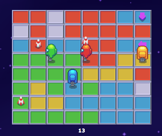</center>

L'objectif du jeu est de peindre le plus de cases de notre couleur pendant 30 secondes. Avant une partie, on peut choisir une difficulté et combien de joueurs participeront :

<center></center>

Après avoir choisi le nombre de joueurs, on peut voir les contrôles pour chaque joueur, lancer la partie ou annuler la partie.

<center>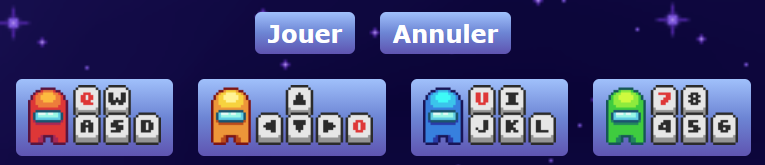</center>

Les **flèches violettes** permettent de peindre une ligne complète. Les **fusées** permettent d'envoyer des projectiles dans 4 directions lorsqu'on appuie sur notre *touche rouge*. (Voir les contrôles plus haut)

<center>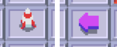</center>

:::note

Bien entendu, initialement, il n'est pas possible de jouer. À mesure que vous compléterez les TODOs, le jeu deviendra fonctionnel.

Notez qu'il existe énormément de code déjà réalisé dans `extra.js`. Vous ne devez pas toucher à ce fichier, tout se passe dans `script.js`.

:::

## 🏁 TODOs

📝 Vous devrez compléter le code dans le fichier `script.js` pour tous les TODOs suivants.

### TODO A et B

Consultez les **variables globales** et notez que vous aurez des **écouteurs d'événements** à créer plus tard, pour certains TODOs.

### TODO 1

L'objectif de la fonction `preparerPartie()` sera de **cacher et d'afficher plusieurs éléments**. (Donc beaucoup de style `display` à modifier)

👻 Les éléments à **cacher** :

Notez que bien que le panneau des scores (en bas) est déjà invisible quand on ouvre la page, il deviendra visible à chaque fois qu'on termine une partie. Il faut donc bel et bien faire le nécessaire pour le cacher dans la fonction `preparerPartie()`.

<center>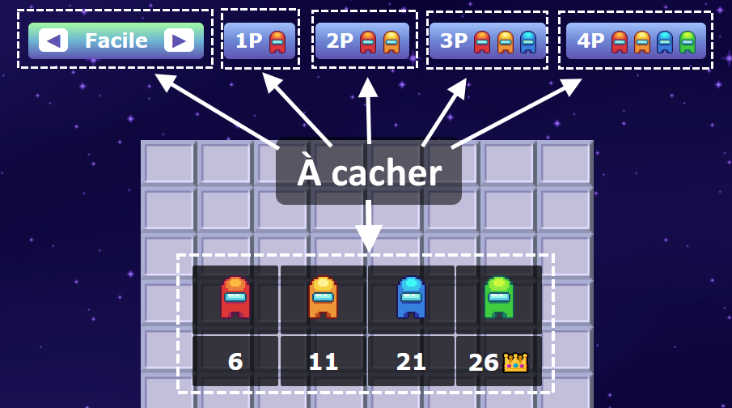</center>

<hr/>

👁 Les éléments à **afficher** :

Il y a de **3 à 6** éléments à afficher.

* On affiche forcément les deux boutons du haut.
* On afficher seulement les contrôles nécessaires parmi les quatre.

<center>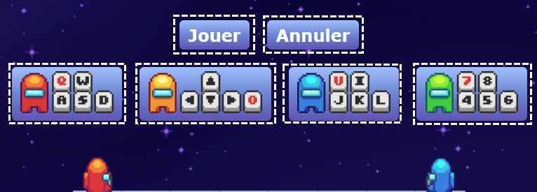</center>

:::info
Comment déterminer combien de contrôles afficher ? Le paramètre `nombreDeJoueurs`, reçu par la fonction `preparerPartie()`, combien le nombre de joueurs humains qui participeront (1, 2, 3 ou 4), donc le nombre de contrôles à afficher. Si seulement trois humains joueront, pas besoin d'afficher les contrôles du personnage vert, par exemple !

Notez que la fonction `preparerPartie()` est déjà appelée lorsqu'on appuie sur n'importe lequel des quatres boutons 1P, 2P, 3P ou 4P. De plus, vous remarquerez que les personnages apparaissent dans l'arène : c'est normal, c'est déjà géré ailleurs dans le code.
:::

### TODO 2

L'objectif sera de rendre fonctionnel les boutons `◄` `►` pour modifier la difficulté du jeu. Ces deux boutons ne sont pas associés à un écouteur d'événements pour le moment !

<center>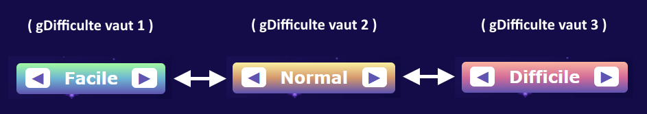</center>

Quand on clique sur `◄`, il faut diminuer la difficulté de 1. Si on était déjà en difficulté 1 (Facile), il ne se passe rien.

Quand on clique sur `►`, il faut augmenter la difficulté de 1. Si on était déjà en difficulté 3 (Difficile), il ne se passe rien.

En tout temps, la variable `gDifficulte` doit contenir 1, 2 ou 3 pour représenter la difficulté actuelle. 

Appliquez la classe `.facile`, `.normal` ou `.difficile` pour obtenir la bonne couleur de fond sur le bouton. (Ce sont ces trois classes qui permettent d'obtenir le dégradé vert, jaune ou rose) Attention par contre, lorsque vous appliquez une des trois classes, n'oubliez pas retirer les deux autres au besoin.

:::tip

Vous risquez d'avoir besoin d'au moins **deux fonctions**. (Une pour chaque bouton ◄ ►) Cela dit, pour obtenir tous les points et éviter de nombreuses répétitions scandaleuses, avoir au moins une troisième fonction sera nécessaire.

:::

Lorsque vous testerez vos fonctions, assurez-vous bien que la variable globale `gDifficulte` reste toujours située entre `1` et `3`, sinon cela brisera le jeu. Les autres éléments à tester sont très visuels, alors vous devriez bien vous en sortir.

<center>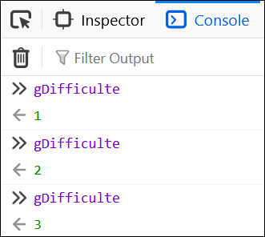</center>

### TODO 3

L'objectif de la fonction `decompte()` est de gérer l'évolution du **décompte** avant le début de la partie. Cette fonction sera appelée dans le **TODO 4**, une fois par seconde, 4 fois, et le résultat sera le suivant :

<center>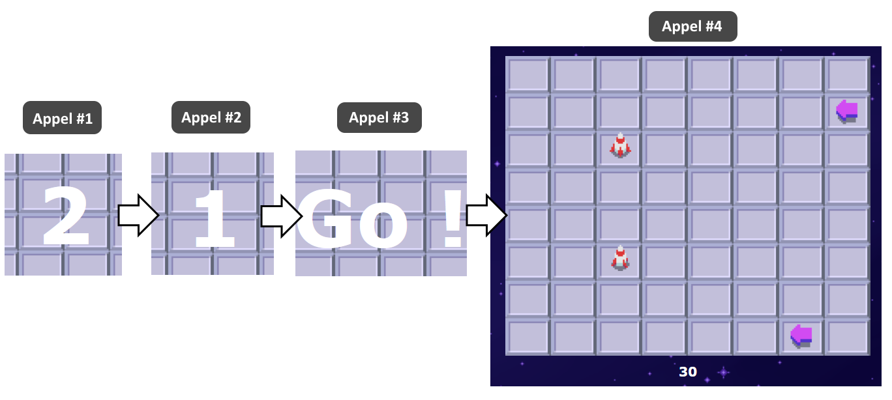</center>

Selon la progression du décompte, on réalise des actions différentes dans `decompte()` :

Dans **tous les cas**, on diminue le décompte de 1 pour commencer. Puis :

* Lorsque le décompte atteint `2` ou `1`, on change seulement le nombre affiché dans la page.
* Lorsque le décompte atteint `0`, on affiche plutôt « Go ! ».
* Lorsque le décompte atteint `-1`, il y a quelques opérations :
  * On **cache** le décompte.
  * On indique, dans la bonne **variable globale**, que le partie devient active.
  * On appelle la fonction `launchGame()`. (Elle existe déjà, dans un autre fichier)
  * ⏳ On met fin au **planificateur** qui appelait `decompte()` une fois par seconde. (Lisez la boîte verte plus bas pour voir de quel planificateur on parle)

(Le fait de rendre la partie « active » fera rapidement apparaître des items dans l'arène. Le fait d'appeler `launchGame()` lancera un chrono qui démarre à `30` en bas du jeu)

:::tip

Pour **tester** cette fonction, étant donné qu'elle n'est pas appelée par un écouteur d'événements, voici comment procéder :

1. D'abord, exécutez ce code dans la console pour que le décompte soit affiché et ait sa valeur de départ :

```js
gDecompte = 3;
document.querySelector(".decompte").textContent = 3;
document.querySelector(".decompte").style.display = "block"; 
```

<center>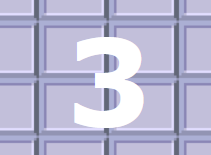</center>

2. Enfin, exécutez ce code dans la console, ce qui permettra d'appeler `decompte()` à toutes les secondes pour tester son comportement :

```js
gPlanifDecompte = setInterval(decompte, 1000);
```

Si vous n'avez pas bien **mis fin au planificateur** lorsque le décompte atteint `-1`, ces messages vont se répéter inutilement dans la console :

<center>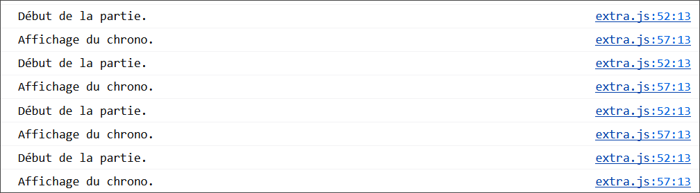</center>

Assurez-vous que ces messages n'apparaissent qu'une seule fois !

:::

### TODO 4

Pour ce TODO, nous rendrons le bouton « Jouer » fonctionnel. Il permettra de lancer le décompte et de débuter une partie. Notez que ce bouton n'appelle aucune fonction présentement.

<center></center>

D'abord, il faudra cacher le bouton « Jouer » et tous les **contrôles** :

<center>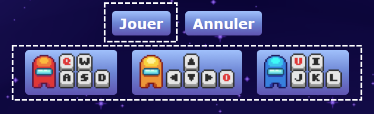</center>

Ensuite, il faudra mettre le **décompte** à son état initial, c'est-à-dire le rendre **visible** et le faire passer à `3` :

<center></center>

Finalement, il faut créer un planificateur à intervalles pour appeler la fonction `decompte()` chaque seconde. N'oubliez pas de faire le nécessaire pour que votre planificateur puisse être **arrêté** grâce au code dans votre **TODO 3** quand le décompte atteint `-1`.

:::tip

Si vous avez bien réalisé le **TODO 4**, le décompte sera lancé... et une fois le décompte terminé, la page ressemblera à ceci et les personnages contrôlés par l'ordinateur commenceront à jouer :

<center>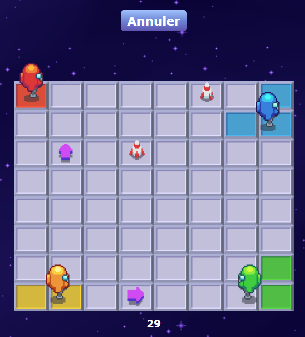</center>

:::

🥳 À ce stade-ci, le jeu est fonctionnel. Le seul bémol est que vous ne pourrez pas utiliser les missiles 🚀 et que le vainqueur ne sera pas anoncé à la fin de la partie.

### TODO 5

Pour ce TODO, il faudra détecter les **touches appuyées** sur le clavier pour permettre aux joueurs d'activer l'item **fusée** 🚀. 

**Activer l'item fusée** correspond à appuyer sur notre *touche rouge* pour envoyer des missiles dans 4 directions.

<center>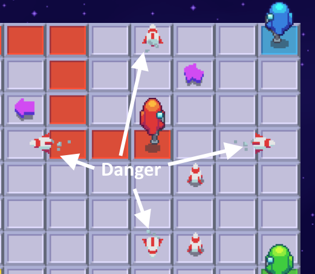</center>

La « touche rouge » associée à chaque joueur est visible dans les images des **contrôles** :

<center></center>

Il n'y aura pas beaucoup de coder à rédiger, il suffit de :

* Vérifier quelle touche a été appuyée.
* Appeler la fonction `activerFusee()` correctement selon la touche.

:::tip

La fonction `activerFusee()` est tout en bas du fichier `script.js`. Lisez bien sa description dans le code pour comprendre comment l'appeler correctement.

Pour **tester** ce TODO exhaustivement, lancer une partie avec **4 joueurs humains**, puis, avec **chaque personnage**, allez attraper une fusée au sol et utilisez la bonne *touche rouge* pour envoyer les missiles. Si les missiles s'envolent bel et bien, c'est bon !

<center>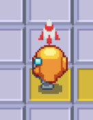 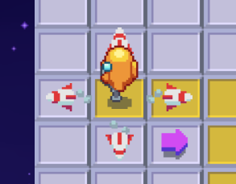</center>

:::

### TODO 6

Le but de ce TODO sera de rendre fonctionnel le panneau des scores à la fin d'une partie :

<center>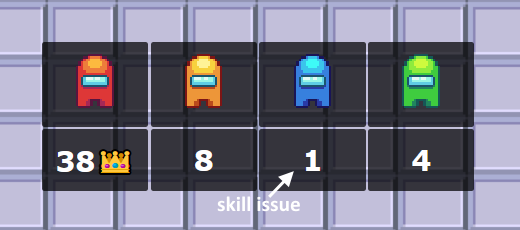</center>

#### 🧮🎨 Étape 1 - Créer une fonction pour compter les cases d'une couleur précise

Créez d'abord une nouvelle fonction qui reçoit le nom d'une couleur (ex : `"rgb(255, 80, 54)"` pour le joueur rouge) en **paramètre**, puis qui compte combien de **cases** dans l'arène possèdent un **fond** de cette couleur, puis qui **retourne** le total.

Vous pourrez tester votre fonction dans la console, comme ceci :

<center>
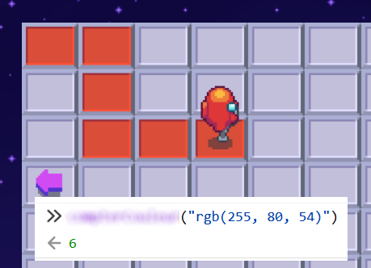

Puisque 6 cases de l'arène ont un **fond rouge**, la fonctione me retourne `6`.
</center>

:::tip

Rappel : on peut vérifier la couleur de fond d'un élément comme ceci : `...style.backgroundColor == "..."`

Voici les couleurs à utiliser pour les 4 joueurs :

* 🔴 P1 - Rouge : `"rgb(255, 80, 54)"`
* 🟡 P2 - Jaune : `"rgb(247, 213, 61)"`
* 🔵 P3 - Bleu : `"rgb(75, 182, 240)"`
* 🟢 P4 - Vert : `"rgb(86, 219, 68)"`

⛔ Copiez ces chaînes de texte EXACTES pour que votre code fonctionne bien.

:::

#### 📊 Étape 2 : Afficher les scores

Complétez la fonction `afficherScores()`. Elle est déjà appelée ailleurs dans le code du jeu, à la fin de la partie.

* Rendez le **panneau des scores** visible.
* Comptez (grâce à votre fonction réalisée plus haut) et affichez le score de chaque joueur.
* Pour le joueur avec le meilleur score, ajoutez le texte `"👑"` après le score.

<center>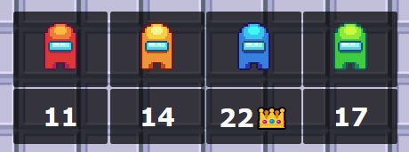</center>

:::note
Vous n'êtes pas obligé de gérer le cas où deux joueurs se partagent la victoire. Si n'importe quel des deux possède la couronne, c'est correct.
:::

## 📐 Exigences supplémentaires

Si les exigences ci-dessous ne sont pas respectées, vous pourriez perdre des points dans des TODOs variés ou dans la catégorie « Pénalités » de la grille de correction.

Il est suggéré de commencer par faire le TP sans se soucier de ces exigences, puis de réviser son travail vers la fin pour respecter les exigences une fois que tout fonctionne bien.

#### 1. Ne pas oublier de point-virgule `;`

N'oubliez pas de conclure toutes vos instructions par `;`. Bien entendu, les **blocs** (if, while, etc.) se terminent par `}` et non par `;`.

#### 2. Soigner l'indentation du code

C'est-à-dire soigner l'alignement / l'espacement de vos lignes de code. N'oubliez donc pas de *spammer* `shift + alt + F`.

#### 3. Éviter le code répétitif

Si vous remarquez plusieurs lignes de code ultra similaires, optez pour des solutions comme :

* Une **boucle** pour le code qui se répète plusieurs lignes d'affilé.
* Une **fonction** qui reçoit de zéro à plusieurs paramètres pour les blocs de code qui se répètent dans plusieurs fonctions / endroits.

#### 4. Chaque nom de fonction ou de variable est approprié et représentatif

Vos noms de variables et de fonctions doivent être pertinents, bien représenter leur rôle et respecter les conventions de nommage vues au cours 2. Il est acceptable de nommer une variable `i` lorsque c'est pour parcourir une boucle, bien entendu.

#### 5. Jamais `document.querySelector()` plusieurs fois avec la même classe dans la même fonction

✅ Ceci est acceptable :

```js showLineNumbers
function maFonction(){

  document.querySelector(".patate").textContent = "Patate";
  document.querySelector(".bateau").style.color = "blue";
  document.querySelector(".poisson").style.width = "50px";

}
```

⛔ Ceci fait perdre des points ( `.patate` présente plusieurs fois ) :

```js showLineNumbers
function maFonction(){

  document.querySelector(".patate").textContent = "Patate";
  document.querySelector(".patate").style.color = "brown";
  document.querySelector(".patate").style.width = "50px";

}
```

✅ Ceci est bien :

```js showLineNumbers
function maFonction(){

  let patate = document.querySelector(".patate");

  patate.textContent = "Patate";
  patate.style.color = "brown";
  patate.style.width = "50px";

}
```

## ✅ Grille de correction

<table>
  <tr>
    <th>Critère</th>
    <th>Points</th>
  </tr>
  <tr>
    <td>TODO B : <br/>- Écouteurs d'événements appropriés créés.</td>
    <td><br/>2 pts</td>
  </tr>
  <tr>
    <td>TODO 1 : <br/>- Affichage et masquage des bons éléments en évitant le code répétitif.</td>
    <td><br/>6 pts</td>
  </tr>
  <tr>
    <td>TODO 2 : <br/>- Modification de la valeur de difficulté cohérente.<br/>- Modification correcte de l'apparence du bouton.<br/>- Usage de stratégies pour éviter les répétitions.</td>
    <td><br/>2 pts<br/>4 pts<br/>4 pts</td>
  </tr>
  <tr>
    <td>TODO 3 : <br/>- Affichage correct du texte du décompte.<br/>- Arrêt du planificateur du décompte.<br/>- Lancement du jeu fonctionnel.</td>
    <td><br/>3 pts<br/>1 pt<br/>1 pt</td>
  </tr>
  <tr>
    <td>TODO 4 : <br/>- État intial du décompte bien configuré.<br/>- Planificateur bien créé pour le décompte.<br/>- Les éléments appropriés sont masqués dans la page, en évitant les répétitions.</td>
    <td><br/>2 pts<br/>1 pt<br/>3 pts</td>
  </tr>
  <tr>
    <td>TODO 5 : <br/>- La touche appuyée est bien déterminée.<br/>- La fonction `activerFusee()` est correctement appelée.<br/></td>
    <td><br/>2 pts<br/>2 pts</td>
  </tr>
  <tr>
    <td>TODO 6 : <br/>- Une fonction appropriée a été créée pour compter et retourner les cases d'une couleur reçue en paramètre. <br/>- Les scores sont visibles et affichés pour chaque joueur, sans code répétitif. <br/>- Une couronne est ajoutée pour le meilleur score.</td>
    <td><br/>5 pts<br/>4 pts<br/>3 pts</td>
  </tr>
  <tr>
    <td colspan="2"><center>Pénalités possibles</center></td>
  </tr>
  <tr>
        <td>- Plagiat et / ou incapable d'expliquer des parties de son code lorsque convoqué(e).<br/>- Usage de notions non abordées en classe. (0 pour le TODO)<br/>- Points-virgules manquants<br/>- Indentations malpropres<br/>- Variables et fonctions bien nommées</td>
        <td>-100%<br/>-2 à -40 pts<br/>-2 pts<br/>-2 pts<br/>-2 pts</td>
    </tr>
  <tr>
      <td>Total</td>
      <td>47 pts</td>
  </tr>
</table>
