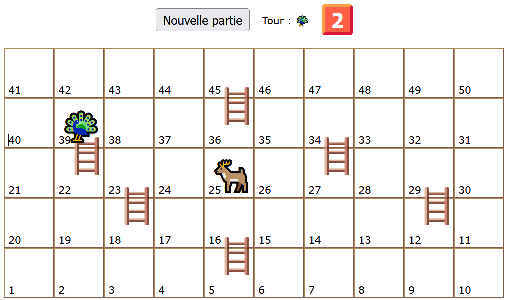
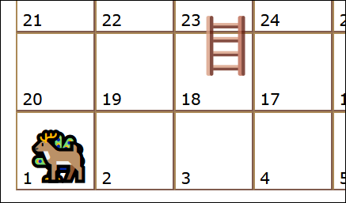
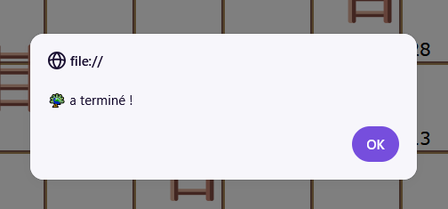

# TP3 - Cerf, paon et échelles 🎲

📦 Projet de départ : Non disponible

📽 Vidéo du résultat attendu : [Lien](https://youtu.be/0PI0N1tz3Mk)

:::warning

Votre résultat final doit être identique à celui dans la vidéo, visuellement. N'oubliez pas de comparer votre version finale à celle dans la vidéo pour être sûr(e) de ne pas oublier d'éléments visuels.

:::

## 📝 Instructions

### 📜 Général

Vous avez le droit d'ajouter autant de **variables globales**, d'**écouteurs d'événements** et de **fonctions** que vous voulez. Il y a beaucoup moins d'instructions que d'habitude pour ce TP, mais le code à réaliser est beaucoup plus court. N'hésitez pas à procéder comme ceci :

1. 🧩 Assurez-vous de comprendre le fonctionnement du jeu. (Vidéo Youtube et questionner l'enseignant(e) au besoin)
2. 👀 Survolez / lisez les sections ⚙ **Fonctionnement** et 💡 **Astuces variées** pour avoir une vue d'ensemble des informations disponibles.
3. 🎹 Commencez à coder. Vous n'êtes pas obligés de commencer par le « début du jeu », vous pouvez commencer par des petits morceaux simples (appelez vos fonctions dans la console pour les tester au besoin) comme :
   * Lancer le dé pour obtenir un nombre aléatoire.
   * Faire avancer un seul personnage dans la grille.
   * Annoncer un vainqueur.
4. ⚙ Complétez le code et assurez-vous que tout fonctionne bien.
5. ⚠ Vérifiez la section 🐞 **Bugs à prévenir** pour êtes sûr(e) que votre jeu est robuste.
6. 😵 Assurez-vous que votre code évite les répétitions frappantes.
7. 💬 Commentez toutes vos fonctions !
8. ✅ Vérifiez la grille de correction si vous le désirez.

### ⚙ Fonctionnement

<table>
    <thead>
        <tr>
            <th>Étape</th>
            <th>Description</th>
        </tr>
    </thead>
    <tbody>
        <tr>
            <td>**Début d'une partie**</td>
            <td>
                

                En cliquant sur le bouton « Nouvelle partie », on peut lancer la partie. Le 🦚 ou le 🦌 sera choisi au hasard pour le premier tour. Les 🦚🦌 sont placés sur la case 1. (C'est important de les placer, car à la fin d'une partie ils ne seront plus sur la case 1)

                :::info

                On peut « lancer une nouvelle partie » à tout moment, même au beau milieu d'une partie en cours.

                :::
            </td>
        </tr>
        <tr>
            <td>**Pendant la partie**</td>
            <td>
                

                Chacun leur tour, les joueurs cliquent sur le dé et voient leur personnage avancer sur la grille. Si un personnage atteint le pied d'une échelle, il est téléporté à son sommet.
            </td>
        </tr>
        <tr>
            <td>**Fin d'une partie**</td>
            <td>
                

                Dès qu'un personnage atteint la case `50`, la partie se termine, le dé devient indisponible et le vainqueur est annoncé.
            </td>
        </tr>
    </tbody>
</table>

### 💡 Astuces variées

<table>
    <thead>
        <tr>
            <th>Astuce</th>
            <th>Description</th>
        </tr>
    </thead>
    <tbody>
        <tr>
            <td>**Lancer du dé**</td>
            <td>
                Un **lancer de dé** se déroule en deux étapes :

                🐇 **Étape 1**, immédiatement :
                * Le dé obtient la classe `rotation`. (Ça fait un petit effet visuel)
                * Un nouveau nombre aléatoire de 1 à 6 est choisi et affiché sur le dé.
                * Le personnage avance dans la grille.
                * Il devient impossible d'appuyer à nouveau sur le dé pour l'instant.

                🐌 **Étape 2**, dans 750 millisecondes :
                * On retire la classe `rotation` du dé.
                * Si le personnage vient d'arriver au pied d'une échelle, il est téléporté au sommet de l'échelle.
                * Le dé redevient utilisable pour le prochain joueur.
            </td>
        </tr>
        <tr>
            <td>**Monter dans une échelle**</td>
            <td>
                Les variables globales `gOrigineEchelles` et `gDestionationEchelles` vous serviront à faire monter les personnages dans les échelles. `gOrigineEchelles` correspond aux cases qui contiennent le **pied** d'une échelle et `gDestinationEchelles` correspond aux cases qui contiennent le **sommet** d'une échelle.

                Par exemple, si un personnage atteint la case à l'index `3` dans `gOrigineEchelles`, ça veut dire qu'on doit le téléporter à la case à l'index `3` dans `gDestinationEchelles`. (Donc de la case `22` à la case `39`)
            </td>
        </tr>
    </tbody>
</table>

### 🐞 Bugs à prévenir

Cette section n'est pas exhaustive, mais elle aborde des bogues qui risquent de se présenter dans votre code.

#### Respecter la grille

Assurez-vous que les personnages ne « sortent » pas de la grille. On ne peut pas déplacer un personnage au-delà de la case `50`.
D'ailleurs, les personnages ne « rebondissent » pas à la fin de la grille. Si on est à la case `48` et qu'on obtient un `3` sur
le dé, on gagne et c'est tout, on ne revient pas en arrière !

#### Dé parfois indisponible

Assurez-vous que le dé ne soit pas utilisable (il ne doit rien se passer si on clique dessus) pendant 750 millisecondes après qu'un
joueur ait cliqué dessus ou encore quand la partie est terminée ou pas encore commencée. D'ailleurs, dans la vidéo, on peut voir qu'un
`"⏳"` est affiché brièvement pendant le lancer du dé.

## ✅ Grille de correction

<table>
    <tr>
        <td>Critères</td>
        <td>Points</td>
    </tr>
    <tr>
        <td>L'initialisation d'une nouvelle partie est bien réalisée.</td>
        <td>3 pts</td>
    </tr>
    <tr>
        <td>Les effets immédiats du lancer de dé sont adéquats. Les effets retardés du lancer de dé sont adéquats. Les échelles fonctionnent comme prévues.</td>
        <td>3 pts 3 pts 5 pts</td>
    </tr>
    <tr>
        <td>La victoire est bien détectée et annoncée.</td>
        <td>3 pts</td>
    </tr>
    <tr>
        <td>Rédaction des commentaires : • Commentaires appropriés. • Français soigné.</td>
        <td> 1.5 pts 2.5 pts</td>
    </tr>
    <tr>
        <td>Qualité du code : • Usage stratégique des structures enseignées.* • Pas ou peu de code répétitif.</td>
        <td> 1 pt 3 pts</td>
    </tr>
    <tr>
        <td>- Plagiat et / ou incapable d'expliquer son code. - Usage de notions non abordées en classe. (0 pour le critère associé) - Points-virgules manquants - Indentations malpropres</td>
        <td>-100% -1 à -25 pts -2 pts -2 pts</td>
    </tr>
    <tr>
        <td>Total</td>
        <td>25 pts</td>
    </tr>
</table>

\* Utilisez les if, else if, else, switch, while, for et conditions ternaires de manière stratégique et élégante.
