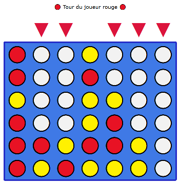
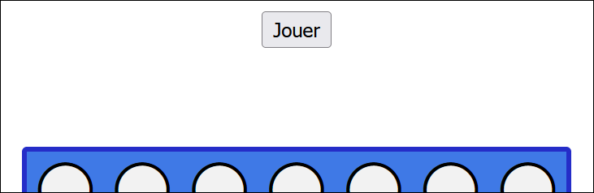
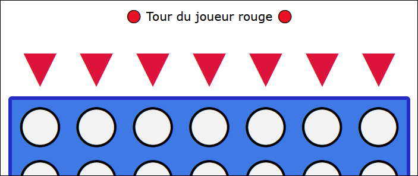
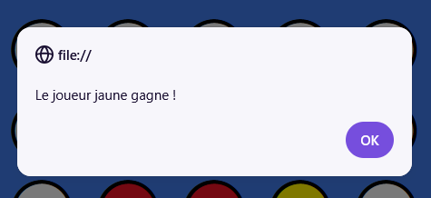
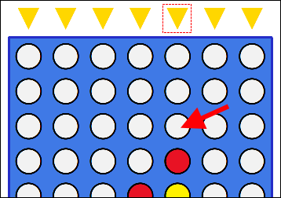
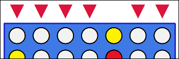

# TP3 - Connectes-en quatre 🧠

📦 Projet de départ : Non disponible

📽 Vidéo du résultat attendu : [Lien](https://youtu.be/IdzWWtku5aA)

:::warning

Votre résultat final doit être identique à celui dans la vidéo, visuellement. N'oubliez pas de comparer votre version finale à celle dans la vidéo pour être sûr(e) de ne pas oublier d'éléments visuels.

:::

## 📝 Instructions

### 📜 Général

Vous avez le droit d'ajouter autant de **variables globales**, d'**écouteurs d'événements** et de **fonctions** que vous voulez. Il y a beaucoup moins d'instructions que d'habitude pour ce TP, mais le code à réaliser est beaucoup plus court. N'hésitez pas à procéder comme ceci :

1. 🧩 Assurez-vous de comprendre le fonctionnement du jeu. (Vidéo Youtube et questionner l'enseignant(e) au besoin)
2. 👀 Survolez / lisez les sections ⚙ **Fonctionnement** et 💡 **Astuces variées** pour avoir une vue d'ensemble des informations disponibles.
3. 🎹 Commencez à coder. Vous n'êtes pas obligés de commencer par le « début du jeu », vous pouvez commencer par des petits morceaux simples (appelez vos fonctions dans la console pour les tester au besoin) comme :
   * Colorier toutes les flèches d'une couleur quelconque.
   * Ajouter un jeton dans la grille
   * Annoncer un vainqueur.
4. ⚙ Complétez le code et assurez-vous que tout fonctionne bien.
5. ⚠ Vérifiez la section 🐞 **Bugs à prévenir** pour êtes sûr(e) que votre jeu est robuste.
6. 😵 Assurez-vous que votre code évite les répétitions frappantes.
7. 💬 Commentez toutes vos fonctions !
8. ✅ Vérifiez la grille de correction si vous le désirez.

### ⚙ Fonctionnement

<table>
    <thead>
        <tr>
            <th>Étape</th>
            <th>Description</th>
        </tr>
    </thead>
    <tbody>
        <tr>
            <td>**Début d'une partie**</td>
            <td>
                

                En cliquant sur le bouton « Jouer », on peut lancer la partie. Le joueur rouge ou jaune sera choisi au hasard pour débuter. Le bouton « Jouer » deviendra invisible dès le début de la partie.
            </td>
        </tr>
        <tr>
            <td>**Pendant la partie**</td>
            <td>
                

                Chacun leur tour, les joueurs cliquent sur une des flèches pour placer un jeton dans une des colonnes de la grille.
                Les jetons vont toujours dans le trou disponible **le plus bas** de la colonne.
            </td>
        </tr>
        <tr>
            <td>**Fin d'une partie**</td>
            <td>
                

                Dès qu'un joueur réussi à aligner 4 jetons consécutifs de sa couleur, il est annoncé comme vainqueur.

                :::info

                Il faut réactualiser la page pour rejouer. Pas besoin de réinitialiser l'état du jeu.

                :::
            </td>
        </tr>
    </tbody>
</table>

### 💡 Astuces variées

<table>
    <thead>
        <tr>
            <th>Astuce</th>
            <th>Description</th>
        </tr>
    </thead>
    <tbody>
        <tr>
            <td>**Placer un jeton**</td>
            <td>
                Pour placer un jeton dans une colonne, il faudra vérifier toute la colonne à la recherche du **dernier** cercle blanc `"⚪"`. Le dernier cercle blanc `"⚪"` trouvé doit être remplacé par le cercle du joueur. (Donc `"🔴"` ou `"🟡"`)

                

                Par exemple, si je choisis la **5e colonne** ... :

                * Est-ce que le texte de l'élément `.trou_5_1` est `"⚪"` ? Oui, on continue ...
                * Est-ce que le texte de l'élément `.trou_5_2` est `"⚪"` ? Oui, on continue ...
                * Est-ce que le texte de l'élément `.trou_5_3` est `"⚪"` ? Oui, on continue ...
                * Est-ce que le texte de l'élément `.trou_5_4` est `"⚪"` ? **Non** ! Je dois placer le jeton dans `.trou_5_3`.
            </td>
        </tr>
        <tr>
            <td>**Colorier les flèches**</td>
            <td>
                Les flèches doivent être coloriées en `"gold"` (jaune) ou en `"crimson"` (rouge) selon le tour du joueur. Remarquez qu'il faut colorier en blanc les flèches des colonnes qui sont **complètement remplies**.

                

                > Comment savoir si une colonne est complète au moment de colorier les flèches ?

                Vérifiez simplement si le texte du premier trou sous la flèche est bien `"⚪"`. Par exemple, quand je m'apprête à colorier l'élément `.fleche3`, je vérifie d'abord si l'élément `.trou_3_1` possède le texte `"⚪"`.
            </td>
        </tr>
    </tbody>
</table>

### 🐞 Bugs à prévenir

Cette section n'est pas exhaustive, mais elle aborde des bogues qui risquent de se présenter dans votre code.

#### Les flèches blanches ne font rien

Si on essaye de placer un jeton dans une **colonne pleine**, il ne doit rien se passer. Donc si on clique sur une flèche blanche, il ne se passe rien et le jeu « attend » qu'on clique sur une flèche valide.

#### On ne peut pas placer de jetons avant le début de la partie

Tant qu'on a pas cliqué sur « Jouer », on remarquera que toutes les flèches sont blanches, mais existent quand même. Il ne faut pas qu'il soit possible de placer un jeton tant que la partie n'est pas lancée.

#### Pas de vainqueur ? Pas d'annonce

Si la partie se conclue en égalité et qu'il n'est plus possible de cliquer sur la moindre flèche, vous n'avez pas à gérer la situation. On réactualise la page pour rejouer et c'est tout !

## ✅ Grille de correction

<table>
    <tr>
        <td>Critères</td>
        <td>Points</td>
    </tr>
    <tr>
        <td>L'initialisation d'une nouvelle partie est bien réalisée.</td>
        <td>2 pts</td>
    </tr>
    <tr>
        <td>La gestion des tours est appropriée. Les flèches sont coloriées adéquatement. Les jetons peuvent être placés adéquatement.</td>
        <td>3 pts 4 pts 6 pts</td>
    </tr>
    <tr>
        <td>La victoire est bien détectée et annoncée.</td>
        <td>2 pts</td>
    </tr>
    <tr>
        <td>Rédaction des commentaires : • Commentaires appropriés. • Français soigné.</td>
        <td> 1.5 pts 2.5 pts</td>
    </tr>
    <tr>
        <td>Qualité du code : • Usage stratégique des structures enseignées.* • Pas ou peu de code répétitif.</td>
        <td> 1 pt 3 pts</td>
    </tr>
    <tr>
        <td>- Plagiat et / ou incapable d'expliquer son code. - Usage de notions non abordées en classe. (0 pour le critère associé) - Points-virgules manquants - Indentations malpropres</td>
        <td>-100% -1 à -25 pts -2 pts -2 pts</td>
    </tr>
    <tr>
        <td>Total</td>
        <td>25 pts</td>
    </tr>
</table>

\* Utilisez les if, else if, else, switch, while, for et conditions ternaires de manière stratégique et élégante.
