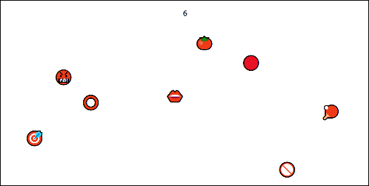
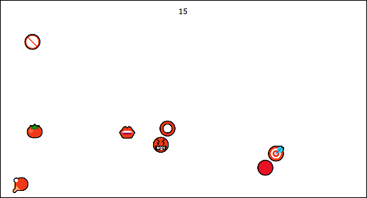
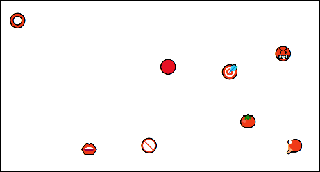
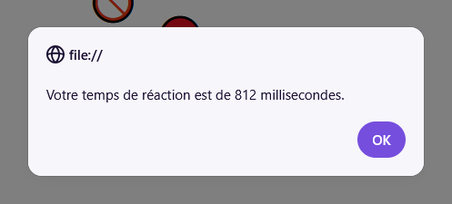

# TP3 - Touche l'oeil du boeuf 🤚

📦 Projet de départ : Non disponible

📽 Vidéo du résultat attendu : [Lien](https://youtu.be/5qBHyLfzC3Q)

:::warning

Votre résultat final doit être identique à celui dans la vidéo, visuellement. N'oubliez pas de comparer votre version finale à celle dans la vidéo pour être sûr(e) de ne pas oublier d'éléments visuels.

:::

## 📝 Instructions

### 📜 Général

Vous avez le droit d'ajouter autant de **variables globales**, d'**écouteurs d'événements** et de **fonctions** que vous voulez. Il y a beaucoup moins d'instructions que d'habitude pour ce TP, mais le code à réaliser est beaucoup plus court. N'hésitez pas à procéder comme ceci :

1. 🧩 Assurez-vous de comprendre le fonctionnement du jeu. (Vidéo Youtube et questionner l'enseignant(e) au besoin)
2. 👀 Survolez / lisez les sections ⚙ **Fonctionnement** et 💡 **Astuces variées** pour avoir une vue d'ensemble des informations disponibles.
3. 🎹 Commencez à coder. Vous n'êtes pas obligés de commencer par le « début du jeu », vous pouvez commencer par des petits morceaux simples (appelez vos fonctions dans la console pour les tester au besoin) comme :
   * Créer un chrono de 15 secondes.
   * Déplacer aléatoirement plusieurs éléments avec la même classe.
   * Calculer la moyenne de tous les nombres dans un tableau.
4. ⚙ Complétez le code et assurez-vous que tout fonctionne bien.
5. ⚠ Vérifiez la section 🐞 **Bugs à prévenir** pour êtes sûr(e) que votre jeu est robuste.
6. 😵 Assurez-vous que votre code évite les répétitions frappantes.
7. 💬 Commentez toutes vos fonctions !
8. ✅ Vérifiez la grille de correction si vous le désirez.

### ⚙ Fonctionnement

<table>
    <thead>
        <tr>
            <th>Étape</th>
            <th>Description</th>
        </tr>
    </thead>
    <tbody>
        <tr>
            <td>**Début d'une partie**</td>
            <td>
                

                
                En cliquant sur le bouton « Jouer », on peut lancer la partie. Le bouton pour jouer est masqué, un chrono de 15 secondes démarre et tous les objets du jeu deviennent visibles et sont placés aléatoirement.
            </td>
        </tr>
        <tr>
            <td>**Pendant la partie**</td>
            <td>
                

                Pendant le jeu, à chaque fois que le joueur clique sur la cible 🎯, tous les objets sont déplacés aléatoirement dans la page et le temps (en millisecondes) depuis le dernier clic sur la cible est pris en note. 
            </td>
        </tr>
        <tr>
            <td>**Fin d'une partie**</td>
            <td>
                

                Lorsque le chrono atteint 0, tous les objets sont masqués, le bouton « Jouer » réapparait et une alerte avec le temps moyen (arrondi aux unités) entre les clics sur la cible 🎯 est affichée.
            </td>
        </tr>
    </tbody>
</table>

### 💡 Astuces variées

<table>
    <thead>
        <tr>
            <th>Astuce</th>
            <th>Description</th>
        </tr>
    </thead>
    <tbody>
        <tr>
            <td>**Déplacer les objets aléatoirement**</td>
            <td>
                `Math.random()` est votre ami. Le but est de donner un style `left` aléatoire entre `"0px"` et `"756px"` et de donner un style `top` aléatoire entre `"0px"` et `"375px"` à tous les objets du jeu.
            </td>
        </tr>
        <tr>
            <td>**Obtenir le délai depuis le dernier clic**</td>
            <td>
                En plus du chronomètre, créez également un deuxième chronomètre qui compte le temps. (À chaque 10 millisecondes pour une précision raisonnable. Évitez un nombre trop petit comme 1 milliseconde, car JavaScript deviendra moins précis) Accumulez simplement le temps qui s'écoule dans une variable globale et lorsque la cible 🎯 sera cliquée, vous pourrez prendre en note le temps qui a été accumulé dans la variable globale en question avant de la remettre à `0`. 
            </td>
        </tr>
        <tr>
            <td>**Obtenir la moyenne de temps entre les clics**</td>
            <td>
                À la fin de la partie, lorsqu'il viendra le temps d'afficher le temps moyen (en millisecondes) entre chaque clic, vous devrez faire la moyenne de tous les délais que vous avez notés. (Probablement dans un tableau, dans une variable globale) Bien entendu, la formule pour obtenir la moyenne correspond à la somme de tous les nombres du tableau, divisée par la longueur du tableau.
            </td>
        </tr>
    </tbody>
</table>

### 🐞 Bugs à prévenir

Cette section n'est pas exhaustive, mais elle aborde des bogues qui risquent de se présenter dans votre code.

#### Les chronomètres doivent s'arrêter

Il est préférable que les deux chronomètres soient arrêtés ou mis sur pause lorsque le jeu est terminé pour éviter des bogues lorsqu'une deuxième manche sera lancée.

#### Délais de clic des manches précédentes

Assurez-vous de ne pas utiliser les délais des manches précédentes au moment de faire le calcul de la moyenne.

## ✅ Grille de correction

<table>
    <tr>
        <td>Critères</td>
        <td>Points</td>
    </tr>
    <tr>
        <td>L'initialisation d'une nouvelle partie est bien réalisée.</td>
        <td>4 pts</td>
    </tr>
    <tr>
        <td>Les objets sont adéquatement déplacés aléatoirement. Le chronomètre principal est fonctionnel et visible. Les délais des clics et le calcul de la moyenne sont bien gérés.</td>
        <td>4 pts 2 pts 5 pts</td>
    </tr>
    <tr>
        <td>La fin du jeu est bien gérée et un message est affiché.</td>
        <td>3 pts</td>
    </tr>
    <tr>
        <td>Rédaction des commentaires : • Commentaires appropriés. • Français soigné.</td>
        <td> 1.5 pts 2.5 pts</td>
    </tr>
    <tr>
        <td>Qualité du code : • Usage stratégique des structures enseignées.* • Pas ou peu de code répétitif.</td>
        <td> 1 pt 2 pts</td>
    </tr>
    <tr>
        <td>- Plagiat et / ou incapable d'expliquer son code. - Usage de notions non abordées en classe. (0 pour le critère associé) - Points-virgules manquants - Indentations malpropres</td>
        <td>-100% -1 à -25 pts -2 pts -2 pts</td>
    </tr>
    <tr>
        <td>Total</td>
        <td>25 pts</td>
    </tr>
</table>

\* Utilisez les if, else if, else, switch, while, for et conditions ternaires de manière stratégique et élégante.
